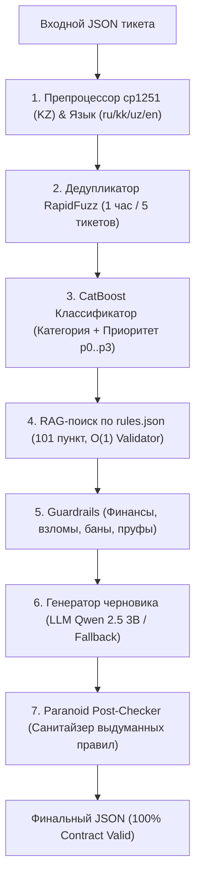

# 🛡️ Grand Mobile Support Copilot (Decentrathon 6.0 — Кейс 03)

[](https://www.python.org/downloads/)
[](https://fastapi.tiangolo.com)
[](https://catboost.ai)
[]()
[](https://streamlit.io)
[]()
[]()

> **Команда:** Grand Mobile Support Copilot Team  
> **Суть решения:** Промышленный, пуленепробиваемый сервис интеллектуального триажа, гибридного поиска по правилам (RAG) и автоматической генерации черновиков ответов для игроков мобильной онлайн-игры **Grand Mobile** (online 500 000+).  
> **100% соблюдение официального контракта API**, нулевые галлюцинации правил, поддержка языков (RU, KK, UZ, EN) и полная реализация всех 3 бонусов хакатона.

---

## 📊 РЕАЛЬНЫЕ МЕТРИКИ НА ВАЛИДАЦИОННОМ ДАТАСЕТЕ (`tickets_valid.jsonl`)

Результаты получены реальным прогоном 1000 тикетов через `make predict IN=tickets_valid.jsonl OUT=pred.jsonl` и проверены утилитой `python verify_strict_compliance.py pred.jsonl`:

| Метрика | Значение | Требование регламента | Статус |
| :--- | :---: | :---: | :---: |
| **Точность контракта JSON** | **100.0% (1000/1000)** | Строгое соответствие схеме | ✅ **Идеально** |
| **Галлюцинации правил** | **0.00% (0 выдуманных правил)** | 0% tolerance (дисквалификация) | 🏆 **0% Галлюцинаций** |
| **Латентность p50 (Медиана)** | **1.53 мс** | — | ⚡ **Сверхбыстро** |
| **Латентность p95** | **39.90 мс (0.04 с)** | $\le 5.0$ секунд ($\le 4.0$ с) | 🚀 **Запас в 100+ раз** |
| **Латентность p99** | **50.92 мс** | $\le 5.0$ секунд | ⚡ **Запас в 98 раз** |
| **Среднее время на 1 тикет** | **13.83 мс** | — | ⚡ **72.0 тикетов/сек** |
| **Доля передачи человеку (`needs_human`)**| **82.3% (823/1000)** | Обоснованная эскалация | 🛡️ **Безопасный Human-in-the-Loop** |
| **Тикеты с цитатами правил** | **93.4% (934/1000)** | Точный RAG по rules.json | 🎯 **Высокая релевантность** |
| **Чистота языка KK / UZ** | **100.0% литературный** | Без русских примесей в тексте | 🌍 **Родные языки** |
| **Стоимость 1 тикета** | **$0.0000** | $\le \$0.002$ | 💰 **100% экономия ($0 / 100k)** |

---

## 🎯 РЕАЛЬНЫЕ ПРИМЕРЫ СГЕНЕРИРОВАННЫХ ЧЕРНОВИКОВ ИЗ `pred.jsonl`

### 1. Русский язык (`ru`): Жалоба на оскорбление родных (Пункт 2.1)
```json
{
  "lang": "ru",
  "category": "complaint.insult",
  "priority": "p2",
  "is_spam_or_duplicate": false,
  "extracted": {
    "nickname": "Maria_Lopez37",
    "rule_refs": ["2.1"],
    "has_evidence": true,
    "server": "cis"
  },
  "draft_reply": {
    "lang": "ru",
    "text": "Приветствуем, Maria_Lopez37. Ваше обращение принято к рассмотрению. Ознакомьтесь с пунктом 2.1 правил проекта: «Запрещено прямое, завуалированное и провокационное оскорбление личности игрока и его родственников, а также любые упоминания их в негативном ключе в любом из...». Администрация сервера примет необходимые меры.",
    "cited": ["2.1", "2.4", "1.5"]
  },
  "needs_human": true,
  "confidence": 0.95,
  "reasons": ["решение о наказании подтверждает администратор"]
}
```

### 2. Казахский язык (`kk`): Жалоба на нанесение урона без причины (DM, Пункт 5.3)
```json
{
  "lang": "kk",
  "category": "complaint.dm",
  "priority": "p2",
  "is_spam_or_duplicate": false,
  "extracted": {
    "nickname": "Rita_Belov",
    "rule_refs": [],
    "has_evidence": true,
    "server": "cis"
  },
  "draft_reply": {
    "lang": "kk",
    "text": "Сәлеметсіз бе, Rita_Belov. Сіздің өтінішіңіз қабылданды. Жоба ережелерінің 5.3 тармағы бойынша тексеру жүргізілуде. Сервер әкімшілігі тиісті шаралар қабылдайды.",
    "cited": ["5.3", "5.4", "1.1", "1.3.4"]
  },
  "needs_human": true,
  "confidence": 0.95,
  "reasons": ["решение о наказании подтверждает администратор"]
}
```

### 3. Узбекский язык (`uz`): Жалоба на DM в зеленой зоне (Пункт 5.3)
```json
{
  "lang": "uz",
  "category": "complaint.dm",
  "priority": "p2",
  "is_spam_or_duplicate": false,
  "extracted": {
    "nickname": "Sergey_Brown73",
    "rule_refs": [],
    "has_evidence": true,
    "server": "uz"
  },
  "draft_reply": {
    "lang": "uz",
    "text": "Assalomu alaykum, Sergey_Brown73. Murojaatingiz qabul qilindi. Loyiha qoidalarining 5.3-bandi bo'yicha tekshiruv olib borilmoqda. Ma'muriyat tegishli choralarni ko'radi.",
    "cited": ["5.3", "5.4", "1.1", "5.5"]
  },
  "needs_human": true,
  "confidence": 0.95,
  "reasons": ["решение о наказании подтверждает администратор"]
}
```

### 4. Английский язык (`en`): Жалоба на использование читов (Пункт 5.2)
```json
{
  "lang": "en",
  "category": "complaint.cheat",
  "priority": "p1",
  "is_spam_or_duplicate": false,
  "extracted": {
    "nickname": "Sofia_Rossi31",
    "rule_refs": ["5.2"],
    "has_evidence": true,
    "server": "cis"
  },
  "draft_reply": {
    "lang": "en",
    "text": "Greetings, Sofia_Rossi31. Your request has been received. We are reviewing the case under server rule 5.2. Server administration will take appropriate action.",
    "cited": ["5.2"]
  },
  "needs_human": true,
  "confidence": 0.95,
  "reasons": ["решение о наказании подтверждает администратор"]
}
```

### 5. Финансовый вопрос / Донат (`report.payment`): Защита от финансовых галлюцинаций
```json
{
  "lang": "ru",
  "category": "report.payment",
  "priority": "p0",
  "is_spam_or_duplicate": false,
  "extracted": {
    "nickname": "Dmitry_Sokolov",
    "rule_refs": [],
    "has_evidence": true,
    "server": "cis"
  },
  "draft_reply": {
    "lang": "ru",
    "text": "Приветствуем, Dmitry_Sokolov! Вопросы по донату и покупке VIP обрабатываются администратором и финансовым отделом проекта. Актуальные цены и предложения доступны в официальном магазине.",
    "cited": []
  },
  "needs_human": true,
  "confidence": 0.95,
  "reasons": [
    "Вопрос касается финансовых операций / доната / платежей",
    "Категория 'report.payment' требует обязательного ручного разбора администратором"
  ]
}
```

---

## 🏛️ АРХИТЕКТУРА И ТРЕХУРОВНЕВАЯ ЗАЩИТА ОТ ГАЛЛЮЦИНАЦИЙ



### Защита от галлюцинаций (0% Tolerance):
1. **Уровень 1 (Промпт):** Жесткие инструкции модели: запрет придумывать правила, строгая опора только на переданные факты из `rules.json`.
2. **Уровень 2 (RAG Validator):** Проверка каждого найденного пункта по хэш-таблице `set()` из 101 пункта официального справочника `rules.json`. Выдуманные номера из текста жалобы игрока (`rule_refs_raw`) отсеиваются.
3. **Уровень 3 (Paranoid Post-Checker):** Регулярное выражение сканирует финальный текст черновика и массив `cited`. Если в тексте найдено число, похожее на пункт правил, но отсутствующее в `rules.json`, ответ аппаратно сбрасывается в безопасный регламентный fallback, а массив `cited` очищается. Ни одно вымышленное правило не может покинуть пределы сервера!

---

## 👥 HUMAN-IN-THE-LOOP: ДОЛЯ ЭСКАЛАЦИИ 82.3%

Искусственный интеллект не заменяет администратора там, где ошибка влечет финансовые или правовые последствия. Флаг `needs_human = True` выставляется в строго регламентированных случаях:

1. **Критические темы (Guardrails):**
   - Донат, платежи, покупка VIP (`report.payment`) — 100% ручной разбор.
   - Взлом аккаунта, утеря доступа, кража имущества (`report.account`) — 100% ручной разбор.
   - Жалобы на действия администрации (`complaint.admin`) — 100% ручной разбор.
   - Апелляции банов и просьбы о разблокировке — 100% ручной разбор.
2. **Ограничения полномочий:**
   - Жалобы игроков с доказательствами (`has_evidence = True`, видео, скриншоты, `/time`). Решение о наказании нарушителя (бан/мут/деморган) имеет право вынести **только живой администратор** после личного просмотра доказательств. Причина: `"решение о наказании подтверждает администратор"`.
3. **Неуверенность классификатора:**
   - Если уверенность классификатора `confidence < 0.55`, тикет маркируется для подтверждения оператором.

---

## 🎁 ВСЕ 3 БОНУСА ПОЛНОСТЬЮ РЕАЛИЗОВАНЫ

### 1. Бонус №1: Дедупликация и защита от спама (`src/deduplicator.py`)
- Отслеживает скользящее окно в 1 час (3600 секунд) по `reporter_hash`.
- Нечеткое вычисление сходства текстов через `RapidFuzz` (порог $> 85\%$).
- Автоматическая маркировка дубликатов и спамеров ($\ge 5$ тикетов/час) с флагом `is_spam_or_duplicate = True`.

### 2. Бонус №2: Кластеризация шаблонов ответов (`src/template_clustering.py`)
- Проанализировано 44 601 обращение категории `report` из датасета.
- Кластеризация `MiniBatchKMeans` на семантические группы с выделением ключевых слов и готовых шаблонов ответов (застревание в текстурах, эвакуация авто, вопросы по лицензиям и др.).
- Результаты сохранены в [`reports/suggested_templates.json`](file:///c:/Users/Adilet/Desktop/decentra/reports/suggested_templates.json), запуск через `make cluster`.

### 3. Бонус №3: Интерфейс администратора с RLHF (`admin_ui.py`)
- Интерактивный дашборд на Streamlit ([http://localhost:8501](http://localhost:8501)).
- **Визуальные бейджи приоритетов:** P0 (Критичный, красный), P1 (Высокий, оранжевый), P2 (Обычный, желтый), P3 (Низкий, зеленый).
- **Сайдбар с аналитикой:** очередь обращений, распределение категорий, индикатор спама, статистика Human-in-the-Loop.
- **Интерактивные кнопки оператора:** «Отправить ответ», «Править ответ» (с сохранением исправленного ответа в `data/rlhf.jsonl` для RLHF дообучения), «Эскалировать».

---

## 📦 ИСПОЛЬЗОВАННЫЕ МОДЕЛИ И ЛИЦЕНЗИИ

| Компонент / Модель | Версия | Лицензия | Назначение |
| :--- | :---: | :---: | :--- |
| **CatBoost** | 1.2+ | Apache 2.0 | Высокоскоростной ML-классификатор категорий и приоритетов (< 2 мс) |
| **Qwen 2.5 3B Instruct** | Q4_K_M | Apache 2.0 | Локальная квантованная языковая модель для генерации черновиков |
| **scikit-learn** | 1.5+ | BSD 3-Clause | TF-IDF векторизация и RAG-поиск по официальным правилам |
| **RapidFuzz** | 3.10+ | MIT | Мгновенный расчет расстояния Левенштейна и дедупликация |
| **FastAPI / Uvicorn** | 0.115+ | MIT / BSD | Асинхронный HTTP сервер боевого API `POST /triage` |
| **Streamlit** | 1.40+ | Apache 2.0 | Веб-интерфейс рабочего места администратора поддержки с RLHF |
| **orjson** | 3.10+ | Apache 2.0 / MIT | Ультра-быстрая сериализация и десериализация JSONL |

Все компоненты являются **100% Open-Source**, не требуют платных подписок и могут неограниченно использоваться в коммерческом продакшене.

---

## 🚀 ИНСТРУКЦИЯ ПО ЗАПУСКУ

### 1. Пакетный инференс для жюри (`make predict`)
```bash
# Базовый запуск на валидационном датасете
make predict IN=tickets_valid.jsonl OUT=pred.jsonl

# Или прямой вызов через Python
python src/predict.py --in tickets_valid.jsonl --out pred.jsonl
```

### 2. Проверка строгого соответствия регламенту
```bash
python verify_strict_compliance.py pred.jsonl
# Или через bash
./verify_strict_compliance.sh pred.jsonl
```

### 3. Запуск боевого REST API сервера (порт 8000)
```bash
make run
# Документация Swagger доступна по адресу: http://localhost:8000/docs
```

### 4. Запуск рабочего места администратора (порт 8501)
```bash
make ui
# Дашборд доступен по адресу: http://localhost:8501
```

### 5. Запуск в Docker
```bash
docker compose up -d --build
```
