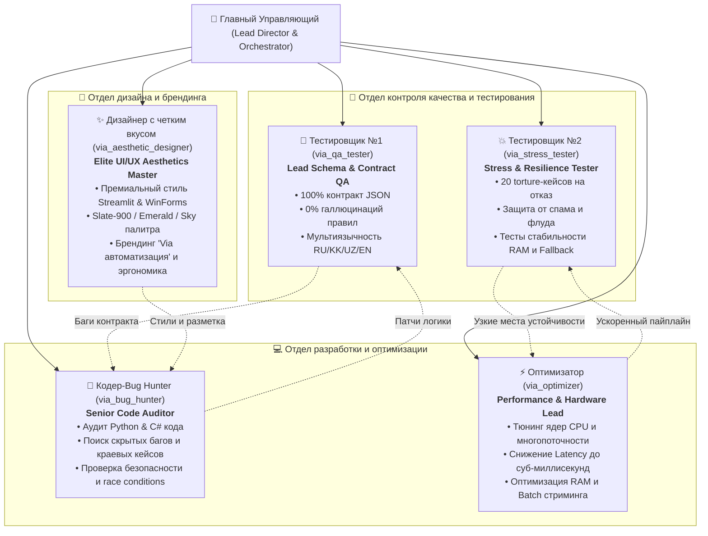

# 🚀 ПРОЕКТ «VIA АВТОМАТИЗАЦИЯ» (VIA AUTOMATION)
## Манифест команды, организационная структура и регламент взаимодействия

---

### 👑 Руководство проектом:
**Главный Управляющий (Lead Director & System Orchestrator)** — координирует всех агентов, утверждает архитектурные решения, объединяет отчеты и представляет результаты заказчику.

---

### 👥 Команда из 5 специализированных агентов:

---

### 📋 Матрица ответственности (RACI):

| Задача / Область | Главный Управляющий | Тестировщик №1 (Схемы) | Тестировщик №2 (Стресс) | Кодер (Bug Hunter) | Оптимизатор (Perf) | Дизайнер (Aesthetics) |
|---|:---:|:---:|:---:|:---:|:---:|:---:|
| **Стратегия и архитектура проекта** | **Accountable (A)** | Consulted (C) | Consulted (C) | Consulted (C) | Consulted (C) | Consulted (C) |
| **Проверка JSON-схемы и правил (0% галлюцинаций)** | Informed (I) | **Responsible (R)** | Consulted (C) | Consulted (C) | - | - |
| **Стресс-тесты организаторов (20 кейсов на отказ)** | Informed (I) | Consulted (C) | **Responsible (R)** | Consulted (C) | Consulted (C) | - |
| **Поиск скрытых багов и ошибок в коде** | Accountable (A) | Consulted (C) | Consulted (C) | **Responsible (R)** | Consulted (C) | - |
| **Ускорение Fast-Path (< 1 мс) и тюнинг CPU/RAM** | Accountable (A) | - | Consulted (C) | Consulted (C) | **Responsible (R)** | - |
| **Визуальный стиль, верстка, бренд и UI/UX** | Accountable (A) | - | - | Consulted (C) | - | **Responsible (R)** |
| **Релиз дистрибутива (EXE, BAT, ZIP) и Git push** | **Responsible (R)** | Consulted (C) | Consulted (C) | Consulted (C) | Consulted (C) | Consulted (C) |

---

### 🎯 Текущие боевые задачи агентов:

1. **Тестировщик №1 (`via_qa_tester`)**:
   - Полная верификация 1000 тикетов из `tickets_valid.jsonl` на соответствие контракту `verify_strict_compliance.py`.
   - Проверка категорий, приоритетов и цитирования реальных правил из `rules.json`.
   - Аудит чистоты ответов на казахском (`kk`) и узбекском (`uz`) языках.

2. **Тестировщик №2 (`via_stress_tester`)**:
   - Прогон 20 кейсов на отказ из `tests/test_organizer_torture.py` и `test_diverse_player_slang.py`.
   - Тестирование экстремальных входных потоков, спама, пустых сообщений, битого JSON.

3. **Кодер-Bug Hunter (`via_bug_hunter`)**:
   - Глубокий аудит файлов `src/pipeline.py`, `src/classifier.py`, `admin_ui.py`, `GrandCopilotApp.cs`, `Setup_GrandCopilot.cs`.
   - Поиск необработанных исключений, утечек дескрипторов, несоответствий дефолтных значений.

4. **Оптимизатор (`via_optimizer`)**:
   - Профилирование задержки каждого шага конвейера.
   - Оптимизация параллелизма в CatBoost (`thread_count`), векторизации и режима `triage_only`.
   - Минимизация выделения оперативной памяти и оптимизация сборщика мусора.

5. **Дизайнер с четким вкусом (`via_aesthetic_designer`)**:
   - Редизайн стилей веб-панели `admin_ui.py` под официальный бренд «Via автоматизация».
   - Улучшение контрастности, типографики, акцентов и анимаций в интерфейсах.
   - Проработка эстетики нативного Windows-окна `GrandCopilotApp.cs`.
